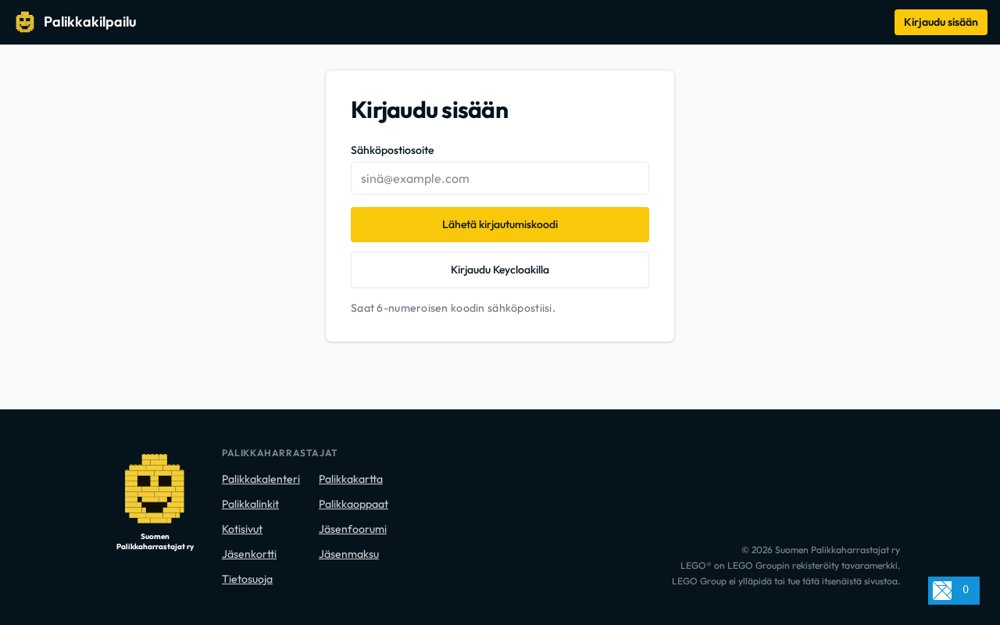
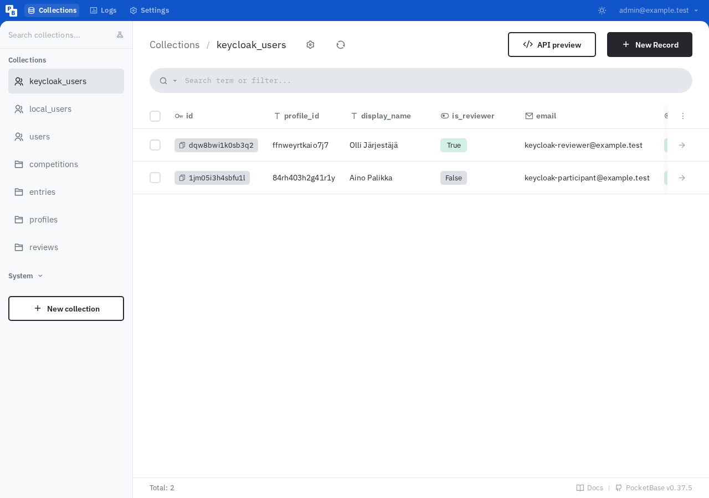
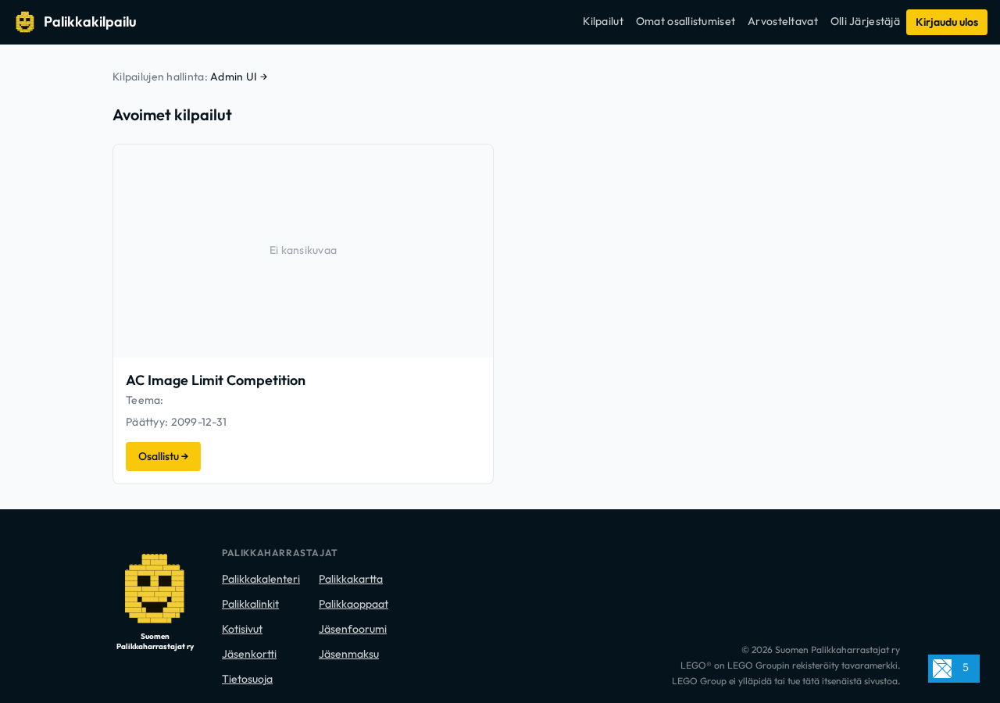
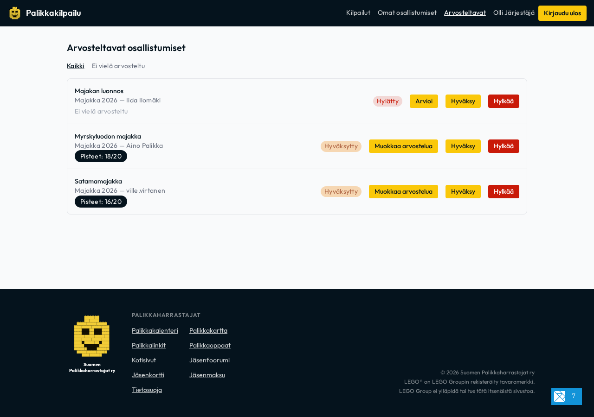
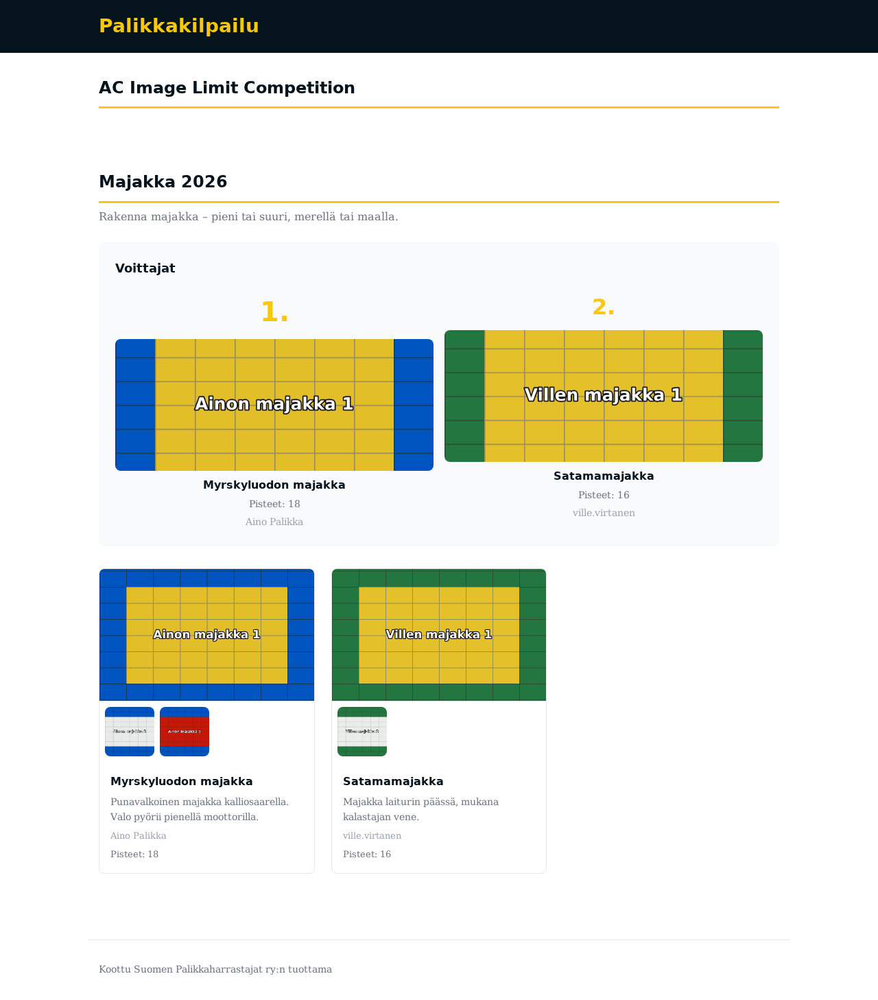
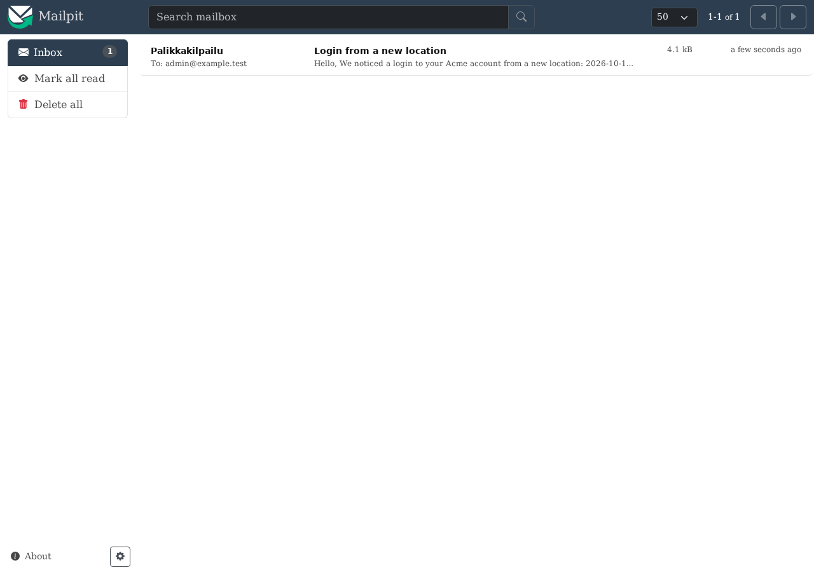

# Kilpailun järjestäjän ja arvostelijan opas
*Competition Organizer & Reviewer Guide* — Suomen Palikkaharrastajat ry

Tämä opas neuvoo Suomen Palikkaharrastajat ry:n kilpailualustan ylläpitäjiä ja arvostelijoita kilpailujen luomisessa, hallinnoinnissa, osallistumistöiden arvioinnissa sekä julkisen tulosgallerian tuottamisessa.

---

## 1. Järjestelmän yleiskuva

Kilpailualusta koostuu kolmesta pääkomponentista:
1. **PocketBase (taustajärjestelmä ja REST API):** Tallentaa kilpailut, osallistumiset (`entries`), arvostelut (`reviews`) ja käyttäjäprofiilit (`profiles`). Tarjoaa ylläpitäjille visuaalisen hallintapaneelin (`/_/`).
2. **Elm SPA (osallistuja- ja arvostelijaliittymä):** Selainsovellus osallistujille töiden jättämiseen ja arvostelijoille töiden arviointiin (`/#/arvostelu`).
3. **Haskell-galleriatyökalu:** Generoi hyväksytyistä töistä ja julkaistuista arvosteluista staattisen, saavutettavan HTML-gallerian (`dist/galleria/index.html`).



---

## 2. Kirjautuminen ja käyttöoikeudet

Alustalla on käytössä **kahden kerroksen käyttäjämalli** (ADR-0003):
- **Kirjautumistilit:** `keycloak_users` (yhdistyksen jäsenet Keycloak SSO -tunnuksella) ja `local_users` (kertakirjautumiskoodi eli OTP sähköpostiin).
- **Profiili (`profiles`):** Jokaisella käyttäjällä on profiili, joka yhdistää osallistumiset ja arvostelut.

### Arvostelijan oikeuksien myöntäminen
1. Avaa PocketBase-hallintapaneeli osoitteessa `http://127.0.0.1:8080/_/` (paikallisesti) tai tuotantopalvelimella.
2. Siirry kokoelmaan **`profiles`**.
3. Etsi henkilön profiili ja aseta rasti kenttään **`is_reviewer = true`**.
4. Tallenna. Käyttäjä näkee nyt Elm-sovelluksessa yläpalkissa linkin **Arvostelu** (`/#/arvostelu`).



---

## 3. Kilpailun luominen ja elinkaari

Kilpailut luodaan PocketBasen **`competitions`**-kokoelmassa.

### Pakolliset ja tärkeät kentät
- **`title`**: Kilpailun nimi (esim. *Linnakilpailu 2026*).
- **`slug`**: URL-ystävällinen tunniste (esim. `linnakilpailu-2026`). Uniikki.
- **`description`**: Kilpailun kuvaus ja teema.
- **`rules`**: Säännöt ja osallistumisohjeet.
- **`status`**: Kilpailun tila (ks. elinkaari alla).
- **`start_date`** & **`end_date`**: Alkamis- ja päättymisaika **ISO-8601 UTC** -muodossa (`YYYY-MM-DDTHH:MM:SS.000Z`).
- **`min_images_per_entry`**: Vähimmäiskuvamäärä työtä kohden (esim. `1`).
- **`max_images_per_entry`**: Enimmäiskuvamäärä työtä kohden (esim. `5`).
- **`cover_image`**: Kilpailun kansikuva (näytetään listauksessa).

### Kilpailun tilat (`status`)
1. **`draft` (Luonnos):** Kilpailu näkyy vain arvostelijoille ja ylläpitäjille. Käytetään tietojen esisyöttöön ja esikatseluun.
2. **`open` (Käynnissä):** Kilpailu on julkinen ja osallistujat voivat lähettää töitä ennen `end_date`-aikaa.
3. **`closed` (Päättynyt):** Töiden jättöaika on päättynyt. Osallistujat eivät voi enää muokata tai jättää töitä. Arvostelijat pisteyttävät työt.
4. **`archived` (Arkistoitu):** Tulokset on julkaistu ja kilpailu on pysyvästi arkistoitu.

---

## 4. Arvostelijan työkalut ja työnkulku

Kun käyttäjällä on `is_reviewer = true`, sovelluksen navigaatioon ilmestyy **Arvostelu**-osio (`/#/arvostelu`).



### Arvostelujonon käsittely
1. Siirry osoitteeseen `/#/arvostelu`.
2. Voit suodattaa töitä kahdella välilehdellä:
   - **Kaikki:** Näyttää kaikki kilpailun työt.
   - **Ei vielä arvosteltu:** Näyttää työt, joita et ole vielä arvostellut.



### Arviointikriteerit ja pisteytys
Jokainen osallistumistyö arvioidaan neljällä kriteerillä asteikolla **1–5**:
1. **Idea ja luovuus (1–5)**
2. **Rakennustekniikka (1–5)**
3. **Esillepano ja kuvaus (1–5)**
4. **Kokonaisvaikutelma (1–5)**

Lisäksi arvostelija antaa sanallista palautetta:
- **Kommentit:** Vapaamuotoinen palaute rakentajalle.

### Arvostelun tilat ja tallennus
- **Tallenna luonnos (Save Draft):** Arvostelu tallentuu PocketBaseen `published = false` -tilassa. Vain arvostelija itse näkee omat luonnoksensa.
- **Julkaise arvostelu (Publish):** Arvostelu asetetaan tilaan `published = true`. Julkaistut arvostelut lasketaan mukaan kilpailun virallisiin pisteisiin ja tulevat rakentajan nähtäville.

### Työn hyväksyminen tai hylkääminen
Arvostelijat tarkistavat, että työ täyttää säännöt:
- **Hyväksy (`approved`):** Työ etenee tuloslaskentaan ja julkiseen galleriaan.
- **Hylkää (`rejected`):** Jos työ rikkoo sääntöjä tai kuvarajoja, se merkitään hylätyksi perustelujen kera.

---

## 5. Tulosten julkaisu ja staattinen galleria

Kun arvostelu on valmistunut ja kilpailu on päättynyt, julkaistaan staattinen galleria.

### Gallerian konfiguraatio (`competition.toml`)
Tiedosto `competition.toml` määrittää gallerian asetukset:
```toml
title = "Palikkaharrastajat — Kilpailugalleria"
base_url = "https://kilpailut.palikkaharrastajat.fi"
output_dir = "dist/galleria"
locale = "fi"
timezone = "Europe/Helsinki"
min_reviews = 1
```

### Gallerian generointi
Aja paikallisessa kehitysympäristössä tai CI/CD-putkessa:
```bash
devenv shell --no-eval-cache -- make gallery-run
```
Komento hakee hyväksytyt työt ja julkaistut arvostelut PocketBasesta, laskee keskiarvopisteet, sijoittaa voittajat (kulta, hopea, pronssi) ja tuottaa valmiin gallerian hakemistoon `dist/galleria/index.html`.



---

## 6. Sähköpostit ja Mailpit paikallisessa kehityksessä

Paikallisessa ympäristössä sähköpostiliikennettä (kuten OTP-kirjautumiskoodeja) valvotaan Mailpitin kautta:
- **Käyttöliittymä:** `http://127.0.0.1:8080/mailpit/`
- **SMTP-portti:** `1025`


