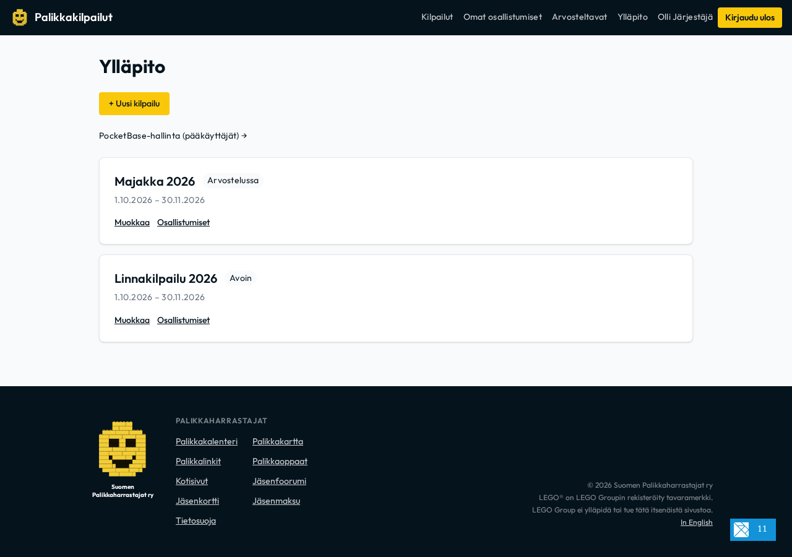
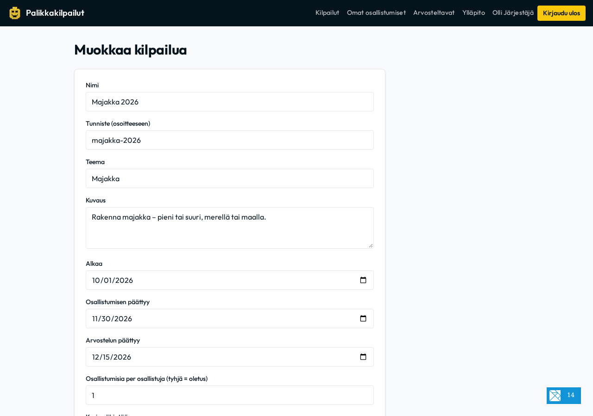
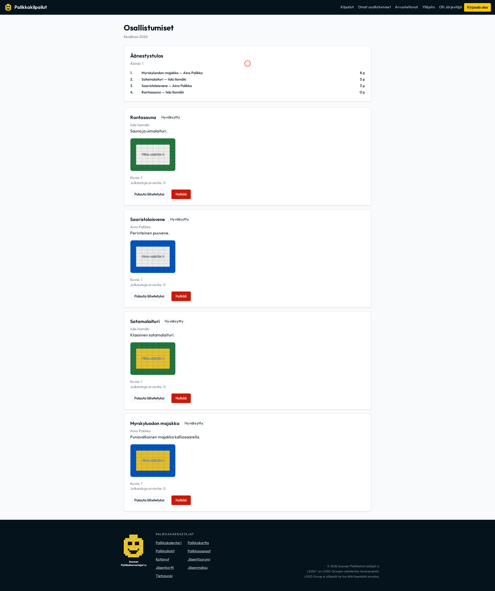
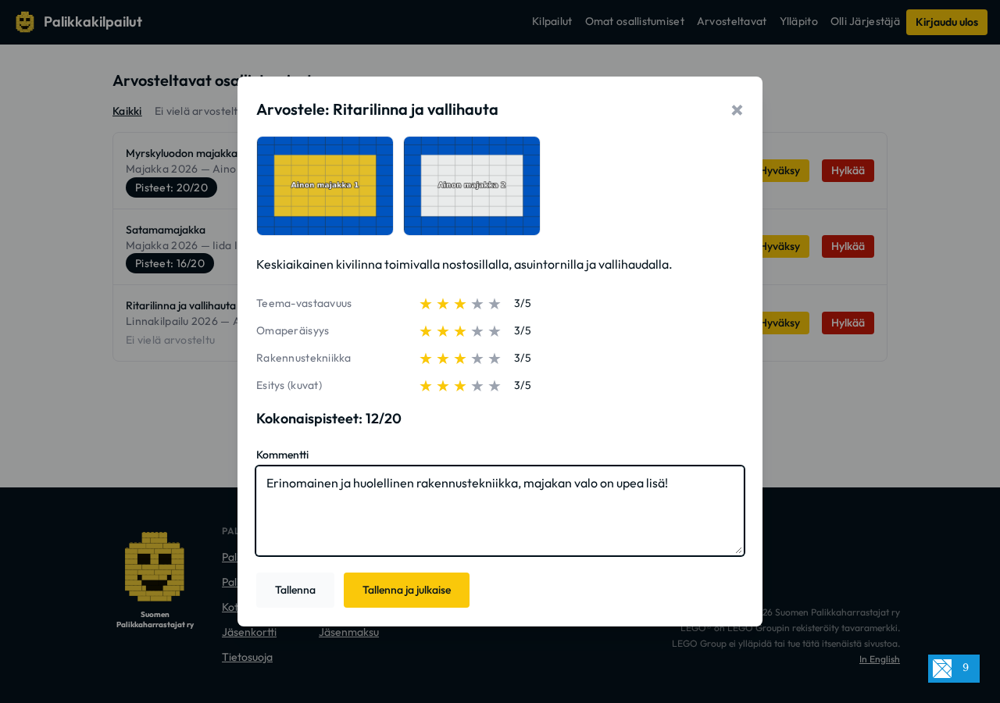

# Kilpailun järjestäjän ja arvostelijan opas
*Competition Organizer & Reviewer Guide* — Suomen Palikkaharrastajat ry

Tämä opas neuvoo Suomen Palikkaharrastajat ry:n kilpailualustan ylläpitäjiä ja arvostelijoita kilpailujen luomisessa sovelluksen ylläpitonäkymässä, osallistumistöiden hallinnoinnissa ja arvioinnissa, yleisöäänestyksen ohjaamisessa sekä julkisen tulosgallerian tuottamisessa.

---

## 1. Järjestelmän yleiskuva

Kilpailualusta koostuu kolmesta pääkomponentista:
1. **Elm SPA (osallistuja-, arvostelija- ja ylläpitoliittymä):** Selainsovellus osallistujille töiden jättämiseen ja äänestämiseen, arvostelijoille töiden pisteytykseen (`/#/arvostelu`) sekä järjestäjille kilpailujen ja osallistumisten hallintaan (`/#/admin`).
2. **PocketBase (taustajärjestelmä ja REST API):** Tallentaa kilpailut, osallistumiset (`entries`), arvostelut (`reviews`), äänet (`votes`) ja käyttäjäprofiilit (`profiles`). Pääkäyttäjille on tarjolla järjestelmätason hallintapaneeli (`/_/`).
3. **Haskell-galleriatyökalu:** Generoi hyväksytyistä töistä, julkaistuista arvosteluista ja yleisöäänestyksestä staattisen, saavutettavan HTML-gallerian (`dist/galleria/index.html`).


---

## 2. Kirjautuminen ja käyttöoikeudet

Alustalla on käytössä **kahden kerroksen käyttäjämalli** (ADR-0003):
- **Kirjautumistilit:** `users` (yhdistyksen jäsenet Keycloak SSO -tunnuksella; sama jäsentili kuin tapahtumakalenterissa) ja `local_users` (kertakirjautumiskoodi eli OTP sähköpostiin).
- **Profiili (`profiles`):** Jokaisella käyttäjällä on profiili, joka yhdistää osallistumiset, arvostelut ja äänestyslipukkeet.

### Arvostelijan ja ylläpitäjän oikeuksien myöntäminen
1. Avaa PocketBase-hallintapaneeli osoitteessa `http://127.0.0.1:8080/_/` (paikallisesti) tai tuotantopalvelimella.
2. Siirry kokoelmaan **`profiles`**.
3. Etsi henkilön profiili ja aseta rasti kenttään **`is_reviewer = true`**.
4. Tallenna. Käyttäjä näkee nyt Elm-sovelluksessa yläpalkissa linkit **Arvosteltavat** (`/#/arvostelu`) ja **Ylläpito** (`/#/admin`).


---

## 3. Kilpailun luominen ja elinkaari sovelluksen ylläpidossa

Kilpailujen hallinnointi tapahtuu suoraan Elm-verkkosovelluksen **Ylläpito**-osiossa (`/#/admin`, ADR-0004). Järjestäjät eivät tarvitse PocketBasen pääkäyttäjätunnuksia arkipäiväiseen kilpailujen luomiseen tai tilasiirtymiin.



### Uuden kilpailun luominen (`/#/admin/kilpailut/uusi`)
Klikkaa ylläpitosivulla painiketta **"+ Uusi kilpailu"**.



### Lomakkeen kentät:
- **Nimi (`title`):** Kilpailun virallinen nimi (esim. *Linnakilpailu 2026*).
- **Tunniste (`slug`):** URL-ystävällinen ja uniikki tunniste (esim. `linnakilpailu-2026`).
- **Teema (`theme`):** Kilpailun teemakuvaus.
- **Kuvaus (`description`):** Tehtävänanto, ohjeistus ja taustatiedot.
- **Alkaa & Osallistumisen päättyy (`start_date` & `end_date`):** Päivät muodossa `YYYY-MM-DD` (tallentuvat keskiyöllä UTC). Osallistujat voivat jättää ja muokata töitään tähän määräaikaan asti.
- **Arvostelun päättyy (`judging_end_date`):** Arviointijakson päättymispäivä.
- **Kuvarajat:** Vähimmäis- ja enimmäiskuvamäärät osallistumista kohden (esim. 1–5 kuvaa).
- **Osallistumisia per osallistuja (`max_entries_per_user`):** Enimmäismäärä töitä per rakentaja (tyhjä = oletus 1).
- **Yleisöäänestyksen asetukset:**
  - **Yleisöäänestys käytössä (`voting_enabled`):** Valitse rasti ottaaksesi käyttöön yleisöäänestyksen arvostelun rinnalla.
  - **Äänestysaika alkaa & päättyy (`voting_start_date` & `voting_end_date`):** Äänestysjakso. Huom: päättymispäivä on ensimmäinen päivä jolloin äänestys EI ole enää auki (klo 00:00 UTC). Jos äänestys päättyy 14.7. klo 23.59, anna loppupäiväksi `2026-07-15`.
  - **Osallistujien on äänestettävä (`voting_required`):** Jos valittu, osallistujan oma työ jää pois äänestystuloksesta, mikäli hän ei itse äänestä kilpailussa.

### Kilpailun tilat ja tilasiirtymät
Kilpailu etenee tilasta toiseen ylläpitolomakkeen painikkeilla **"Siirrä tilaan: …"**:
1. **Luonnos (`draft`):** Kilpailu näkyy vain arvostelijoille ja ylläpitäjille.
2. **Avoin (`open`):** Kilpailu on julkinen ja osallistujat voivat lähettää sekä muokata töitään.
3. **Suljettu (`closed`):** Osallistumisaika on päättynyt.
4. **Arvostelussa (`judging`):** Arvostelijat pisteyttävät töitä. Yleisöäänestys voi olla käynnissä.
5. **Päättynyt (`finished`):** Kilpailu on ratkennut ja valmis julkaistavaksi staattiseen galleriaan.

> [!NOTE]
> Kilpailujen poistaminen on sallittu vain PocketBasen pääkäyttäjille (`/_/`), koska poisto tuhoaa myös kaikki kilpailun työt ja arviot. Ylläpitosivulla on suora linkki PocketBase-hallintaan pääkäyttäjätehtäviä varten.

---

## 4. Osallistumisten hallinta ja arvostelijan työkalut

Reviewereillä on käytössään kaksi toisiaan täydentävää näkymää: osallistumisten hallintapaneeli (`/#/admin/osallistumiset/<id>`) ja arviointijono (`/#/arvostelu`).

### 4.1 Kilpailun osallistumisten hallinta (`/#/admin/osallistumiset/<id>`)
Ylläpidon kautta pääset tarkastelemaan kilpailun kaikkia töitä yhdellä silmäyksellä:



- Näet kaikki työt (myös luonnokset), niiden tekijät, kuvaluvut ja julkaistut arviot.
- Voit **Hyväksyä** (`approved`) tai **Hylätä** (`rejected`) töitä tai palauttaa ne tilaan **Lähetetty**.
- Jos kilpailussa on yleisöäänestys, näet sivulla reaaliaikaisen äänestystilanteen:
  - Annettujen äänestyslipukkeiden määrä.
  - Sijoitukset, pisteet ja 1. sijojen määrä.
  - Pakollisen äänestyksen vuoksi hylätyt / tuloksen ulkopuolelle jäävät työt.

### 4.2 Arvostelujonon käsittely (`/#/arvostelu`)
Arvostelijat avaavat yläpalkista **Arvosteltavat** (`/#/arvostelu`):


1. Voit suodattaa töitä kahdella välilehdellä:
   - **Kaikki:** Kaikki osallistumiset ja niiden tila.
   - **Ei vielä arvosteltu:** Työt, joille et ole vielä antanut julkaistua arviota.
2. Avaa työ klikkaamalla **"Arvioi"**.
3. Pisteytä kriteerit asteikolla **1–5 tähteä**:
   - Arviointikriteerit määritellään tiedostossa `config.toml` (ADR-0005). Oletuksena käytössä on neljä kriteeriä: *Teema-vastaavuus*, *Omaperäisyys*, *Rakennustekniikka* ja *Esitys (kuvat)*.
4. Kirjoita sanallinen palaute kohtaan **Kommentti**.
5. Valitse tallennustapa:
   - **Tallenna:** Tallentaa luonnoksen (`is_published = false`), joka näkyy vain sinulle.
   - **Tallenna ja julkaise:** Julkaisee arvion (`is_published = true`), jolloin pisteet ja palaute tulevat tekijän näkyville ja lasketaan kilpailun kokonaistulokseen.
6. Hyväksy tai hylkää työ painikkeilla **"Hyväksy"** tai **"Hylkää"**.



---

## 5. Yleisöäänestyksen toteutus (Ranked Voting)

Yleisöäänestys (ADR-0007) toimii tuomaristoarvostelun rinnalla tuottaen oman itsenäisen tuloslistansa:

- **Ketkä voivat äänestää:** Kaikki kirjautuneet käyttäjät (jäsenet ja OTP-vieraat).
- **Äänestyslipuke:** Äänestäjä valitsee 1–5 hyväksyttyä työtä paremmuusjärjestyksessä.
- **Pisteiden laskenta (8-5-3-2-1):**
  - 1. sija: 8 pistettä
  - 2. sija: 5 pistettä
  - 3. sija: 3 pistettä
  - 4. sija: 2 pistettä
  - 5. sija: 1 piste
  - Tasapisteissä ratkaisevat 1. sijojen määrä, sitten 2. sijojen määrä jne.
- **Salainen lippuäänestys:** Yksittäiset äänestyslipukkeet ovat salaisia (näkyvät vain äänestäjälle itselleen ja järjestäjille ylläpidossa). Julkisuuteen esitetään vain koottu lopputulos.

---

## 6. Tulosten julkaisu ja staattinen galleria

Kun kilpailu on tilassa `finished` ja äänestysaika on päättynyt, julkaistaan staattinen galleria.

### Gallerian asetukset (`competition.toml`)
```toml
title = "Palikkakilpailut"
locale = "fi"
timezone = "Europe/Helsinki"
output_dir = "dist/galleria"
```

### Gallerian generointi
Aja paikallisessa kehitysympäristössä tai julkaisuputkessa:
```bash
devenv shell --no-eval-cache -- make gallery-run
```
Komento hakee hyväksytyt työt, julkaistut arvostelut ja äänet PocketBasesta, muodostaa palkintopallin, laskee arvosanojen keskiarvot sekä yleisöäänestyksen pisteet ja kirjoittaa saavutettavan HTML-gallerian hakemistoon `dist/galleria/index.html`.

> [!IMPORTANT]
> Gallerian luonti tarvitsee superuser-oikeudet (`POCKETBASE_API_KEY` ympäristömuuttujassa, ks. `.env`), jotta pipeline voi lukea salaiset äänestyslipukkeet ja osallistujien näyttönimet yleisöäänestystuloksen laskentaa varten.


---

## 7. Paikallisen kehityksen apuvälineet

- **Sähköpostit (Mailpit):** OTP-tunnuskoodit näkyvät selaimessa osoitteessa `http://localhost:8080/mailpit/`.
- **PocketBase Admin:** `http://localhost:8080/_/` (pääkäyttäjille roolien hallintaan).
- **Keycloak SSO:** `http://localhost:8080/auth/`.
