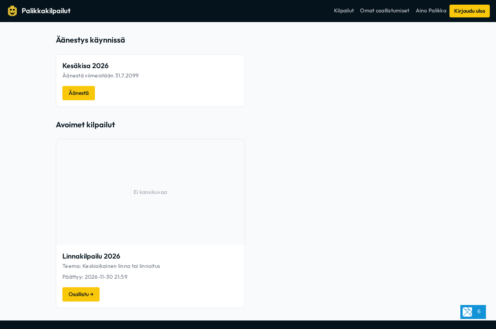
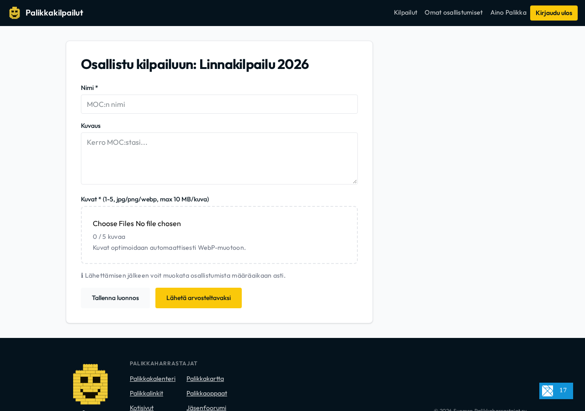
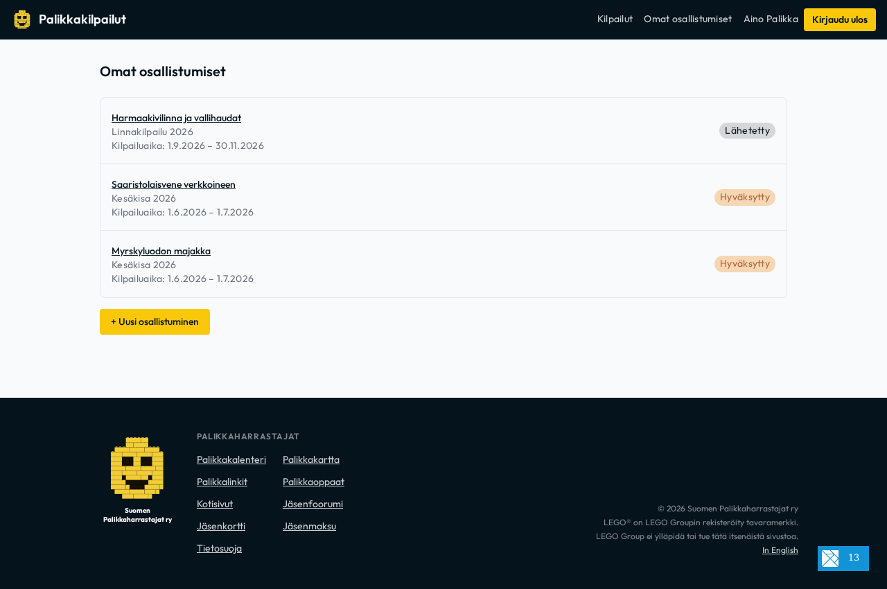
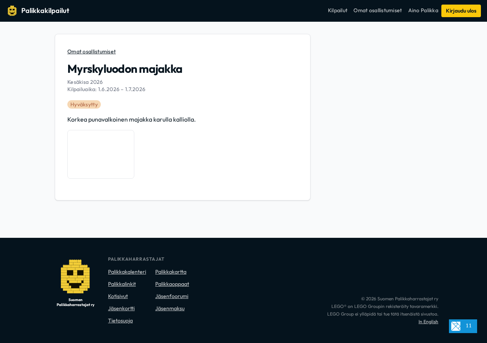
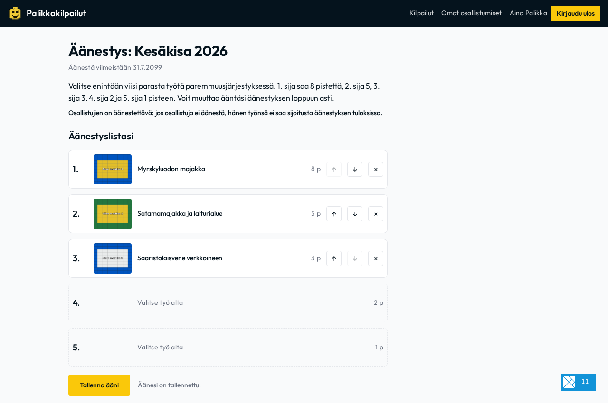

# Kilpailijan ja osallistujan opas
*Participant Guide* — Suomen Palikkaharrastajat ry

Tervetuloa osallistumaan Suomen Palikkaharrastajat ry:n LEGO-rakennuskilpailuihin! Tässä oppaassa käydään läpi kirjautuminen, kilpailutyön luominen ja kuvien lisääminen, osallistumisen seuranta ja muokkaaminen, yleisöäänestykseen osallistuminen sekä tulosgallerian katselu.

---

## 1. Kirjautuminen palveluun

Palveluun voi kirjautua kahdella eri tavalla:

1. **Jäsenkirjautuminen (Keycloak SSO):**
   - Suomen Palikkaharrastajat ry:n jäsenille.
   - Klikkaa **"Kirjaudu Keycloakilla"**, jolloin siirryt yhdistyksen keskitettyyn jäsenpalveluun.
2. **Kertakirjautuminen sähköpostilla (OTP):**
   - Avoimiin kilpailuihin osallistuville tai vieraille.
   - Syötä sähköpostiosoitteesi ja klikkaa **"Lähetä kirjautumiskoodi"**.
   - Saat sähköpostiisi 6-numeroisen vahvistuskoodin. Syötä koodi lomakkeeseen vahvistaaksesi kirjautumisen. Salasanaa ei tarvita!

---

## 2. Profiili ja nimimerkki

Kun olet kirjautunut sisään, näet oikeassa yläkulmassa käyttäjätietosi.

- Ensimmäisellä kirjautumiskerralla järjestelmä pyytää asettamaan julkisen nimimerkin (`display_name`).
- Tätä nimimerkkiä käytetään osallistumistöissäsi sekä julkisessa tulosgalleriassa.
- Voit myös halutessasi valita työn jättämisen anonyymisti, jolloin nimeäsi ei näytetä julkisesti kilpailun aikana.

---

## 3. Kilpailuun osallistuminen

Etusivulla näkyvät kaikki käynnissä olevat kilpailut. Klikkaa avoimen kilpailun kohdalta **"Osallistu →"**.

### Lomakkeen täyttäminen
1. **Teoksen nimi:** Anna rakennelmallesi kuvaava otsikko.
2. **Kuvaus:** Kerro teoksen taustatarinasta, rakennustekniikoista, käytetyistä osista ja muista mielenkiintoisista yksityiskohdista.
3. **Kuvat:**
   - Lisää kuvia laitteeltasi.
   - **Automaattinen optimointi:** Selain optimoi ja pakkaa kuvat automaattisesti moderniin WebP-muotoon (enintään 2000px leveys/korkeus, 85% laatu) ennen lähetystä.
   - **Kuvarajat ja esikatselu:** Lomake näyttää kilpailun vaatiman kuvarajan (esim. vähintään 1 ja enintään 5 kuvaa). Lisätyt kuvat näkyvät heti suurina esikatseluruutuina, joiden päällä näkyy tiedostonimi työkaluvihjeenä (tooltip).
   - Voit poistaa kuvia valitsemalla "Poista kuva".

### Luonnos vai lopullinen lähetys?
- **Tallenna luonnos:** Voit tallentaa työn luonnoksena ja jatkaa muokkaamista myöhemmin. Luonnostilassa kuvarajat eivät estä tallennusta.
- **Lähetä arvosteltavaksi:** Kun teoksesi on valmis ja kuvarajat täyttyvät, klikkaa **"Lähetä arvosteltavaksi"** ja vahvista lähetys.
- **Työn muokkaaminen lähettämisen jälkeen:** Voit muokata jo lähetettyä työtä ja sen kuvia vapaasti aina kilpailun ilmoittautumisajan päättymiseen (`end_date`) saakka!

---

## 4. Omien osallistumisten seuranta ja muokkaaminen

Löydät omat teoksesi ylänavigaation kohdasta **Omat osallistumiset** (`/#/omat`).

### Oman työn tarkastelu (`/#/omat/<id>`)
Klikkaamalla osallistumisen otsikkoa avautuu työn oma sivu:

Sivulla näet:
- Kilpailun nimen ja aikajänteen (ilmoittautumisaika ja arvosteluaika).
- Työn tilan (Luonnos, Lähetetty, Hyväksytty, Hylätty).
- Suuret kuvatiilet tiedostonimineen.
- **"Muokkaa"**-painikkeen, jolla voit päivittää teoksen tietoja tai kuvia aina määräaikaan asti.

### Työn tilat
- **Luonnos (`draft`):** Työ on keskeneräinen. Voit muokata sitä vapaasti.
- **Lähetetty (`submitted`):** Työ on lähetetty kilpailuun. Voit edelleen muokata sitä kilpailun määräaikaan asti.
- **Hyväksytty (`approved`):** Arvostelijat ovat hyväksyneet työn kilpailuun mukaan. Työ osallistuu pisteytykseen, mahdolliseen yleisöäänestykseen ja päätyy julkiseen galleriaan.
- **Hylätty (`rejected`):** Työ ei täyttänyt kilpailun sääntöjä. Näet arvostelijan antaman perustelun.

### Palautteet ja pisteet
Kun kilpailu päättyy ja arvostelijat ovat julkaisseet arvionsa, näet omien töidesi kohdalla:
- Kokonaispisteet ja kriteerikohtaiset tähdet (1–5)
- Arvostelijoiden sanalliset palautteet ja kommentit

---

## 5. Kilpailutöiden äänestäminen (Yleisöäänestys)

Kilpailuissa voi olla arvostelijoiden pisteytyksen rinnalla **yleisöäänestys** (ADR-0007).

Kun kilpailussa on äänestysaika käynnissä, etusivulla näkyy osio **"Äänestys käynnissä"** sekä **"Äänestä"**-painike.

### Äänestäminen askel askeleelta:
1. Klikkaa **"Äänestä"** avataksesi kilpailun äänestyssivun (`/#/aanestys/<id>`).
2. Sivulla näkyvät kilpailun hyväksytyt työt. Klikkaa teoksen kohdalta **"Valitse"** lisätäksesi sen omalle äänestyslistallesi.
3. Voit valita enintään **5 suosikkityötäsi**, jotka sijoittuvat paremmuusjärjestykseen 1.–5.
   - **1. sija:** 8 pistettä
   - **2. sija:** 5 pistettä
   - **3. sija:** 3 pistettä
   - **4. sija:** 2 pistettä
   - **5. sija:** 1 piste
4. Voit vaihtaa teosten järjestystä ylös/alas-nuolipainikkeilla tai poistaa teoksen listalta.
5. Klikkaa **"Tallenna ääni"**. Voit muuttaa tai päivittää ääntäsi milloin tahansa äänestysajan päättymiseen asti!
6. **Pakollinen äänestys:** Jos kilpailussa on sääntö *"Osallistujien on äänestettävä"*, osallistujan oma työ ei saa sijoitusta äänestyksessä, ellei osallistuja itse äänestä.

---

## 6. Tulosgallerian selaaminen

Kilpailun päätyttyä tulokset julkaistaan virallisessa staattisessa tulosgalleriassa.

- **Voittajakoroke:** Kulta-, hopea- ja pronssisijoitetut teokset esitellään näyttävästi pisteineen.
- **Yleisöäänestyksen tulokset:** Jos kilpailussa järjestettiin yleisöäänestys, sen tulokset ja pisteet näkyvät galleriassa omana tuloslistanaan.
- **Kuvagalleria & Lightbox:**
  - Klikkaamalla mitä tahansa kuvaa avaat koko ruudun esteettömän Lightbox-esikatselun.
  - Selaa kuvia näppäimistön nuolinäppäimillä (`←` ja `→`) tai klikkaamalla nuolia.
  - Sulje esikatselu `Esc`-näppäimellä tai sulkemispainikkeesta.
